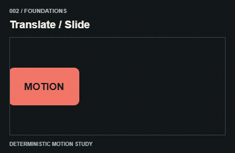
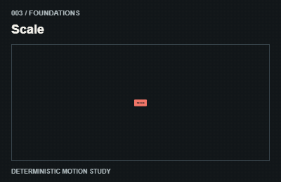
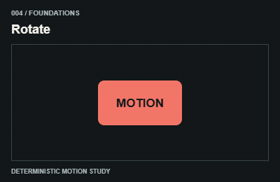
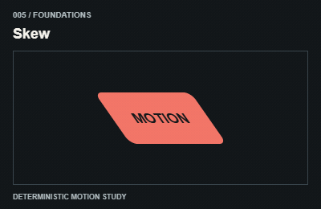
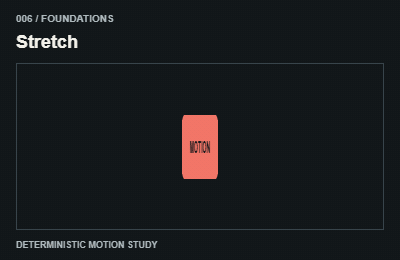
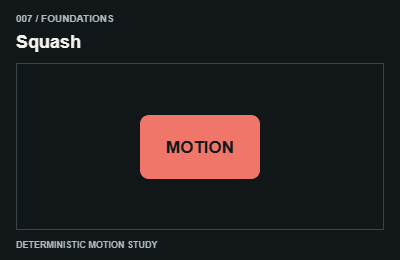
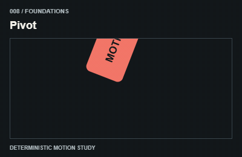
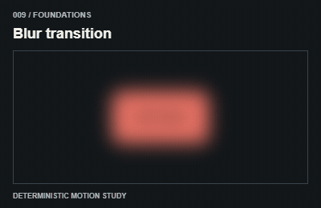
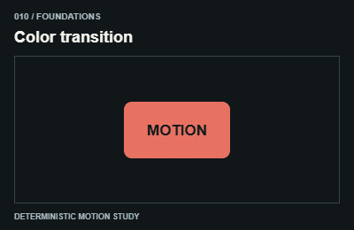

# Foundations / Nền tảng

Transform, opacity, filter or color interpolation. Keep a stable wrapper and animate a child.

The GIFs are compact teaching studies. Keep the host application state separate from their visual timelines.

[All 240 entries](../catalog.md)

| ID / effect | GIF |
| --- | --- |
| [001 · Fade](001-fade.md) Đổi độ trong suốt |  |
| [002 · Translate / Slide](002-translate-slide.md) Dịch vị trí |  |
| [003 · Scale](003-scale.md) Phóng to thu nhỏ |  |
| [004 · Rotate](004-rotate.md) Xoay quanh tâm |  |
| [005 · Skew](005-skew.md) Nghiêng theo trục |  |
| [006 · Stretch](006-stretch.md) Kéo giãn |  |
| [007 · Squash](007-squash.md) Ép dẹt |  |
| [008 · Pivot](008-pivot.md) Xoay quanh bản lề |  |
| [009 · Blur transition](009-blur-transition.md) Từ mờ sang rõ |  |
| [010 · Color transition](010-color-transition.md) Chuyển màu |  |
