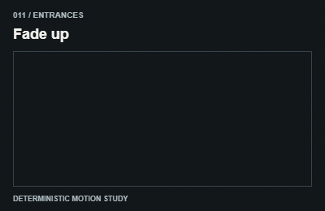

# 011 — Fade up

Hiện dần và đi lên

**Category:** Entrances · **Kind:** effect

## Implementation recipe

Combine opacity 0 to 1 with translateY 30px to zero.

Animate toward the natural visible layout; do not leave content hidden if JavaScript fails.

**Starting timing:** start around 850ms for a discrete transition; ongoing indicators follow real activity and stop when it ends. The 3-second teaching GIF is not a required production duration.

## Adaptation checks

End in the intended readable, interactive state. Do not retain a clipped, distorted or transparent final control.

Preserve focus, selected items and form/demo state. Respect reduced motion and stop work in hidden views.

Verify a real intermediate frame and the settled state; do not infer visible movement from a class or animation object alone.

## Demo source

[Deterministic renderer](../../assets/catalog/demo-engine.mjs): zero-based group 1, branch 0. Call `drawDemo(context, 11, normalizedTime)` on a 400 × 260 Canvas. The full source is study material; port only the selected mechanism into production.

[Group GIFs](02-entrances.md) · [Catalog index](../catalog.md) · [Reliability](../reliability.md)
