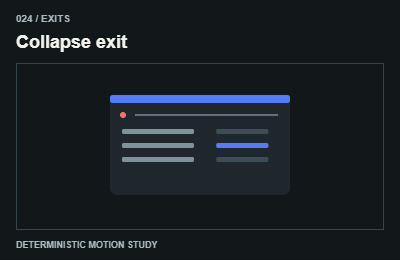

# 024 — Collapse exit

Co vùng nội dung

**Category:** Exits · **Kind:** effect

## Implementation recipe

Animate measured height or grid row size before removal.

Keep the departing node until its exit finishes; move focus before removing an interactive region.

**Starting timing:** start around 850ms for a discrete transition; ongoing indicators follow real activity and stop when it ends. The 3-second teaching GIF is not a required production duration.

## Adaptation checks

Keep the outgoing content until its transition completes, restore focus safely, then remove it.

Preserve focus, selected items and form/demo state. Respect reduced motion and stop work in hidden views.

Verify a real intermediate frame and the settled state; do not infer visible movement from a class or animation object alone.

## Demo source

[Deterministic renderer](../../assets/catalog/demo-engine.mjs): zero-based group 2, branch 3. Call `drawDemo(context, 24, normalizedTime)` on a 400 × 260 Canvas. The full source is study material; port only the selected mechanism into production.

[Group GIFs](03-exits.md) · [Catalog index](../catalog.md) · [Reliability](../reliability.md)
