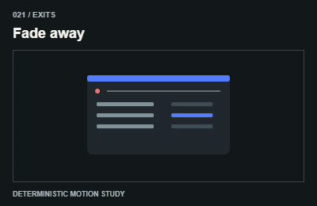
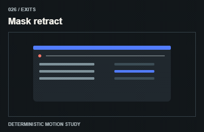
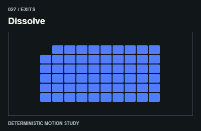
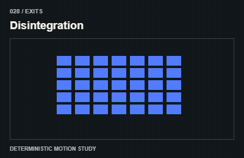
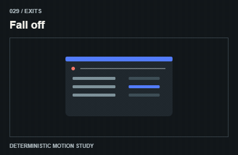
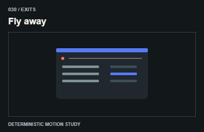

# Exits / Biến mất

Keep the departing node until its exit finishes; move focus before removing an interactive region.

The GIFs are compact teaching studies. Keep the host application state separate from their visual timelines.

[All 240 entries](../catalog.md)

| ID / effect | GIF |
| --- | --- |
| [021 · Fade away](021-fade-away.md) Tan dần |  |
| [022 · Shrink out](022-shrink-out.md) Thu nhỏ biến mất |  |
| [023 · Zoom out exit](023-zoom-out-exit.md) Lùi xa |  |
| [024 · Collapse exit](024-collapse-exit.md) Co vùng nội dung |  |
| [025 · Slide out](025-slide-out.md) Trượt ra ngoài |  |
| [026 · Mask retract](026-mask-retract.md) Mask khép lại |  |
| [027 · Dissolve](027-dissolve.md) Tan theo vùng |  |
| [028 · Disintegration](028-disintegration.md) Phân rã thành mảnh |  |
| [029 · Fall off](029-fall-off.md) Rơi khỏi bố cục |  |
| [030 · Fly away](030-fly-away.md) Bay khỏi vị trí |  |
