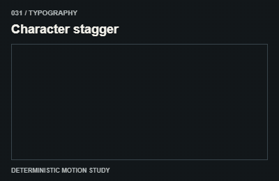
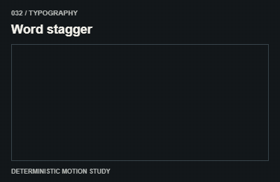
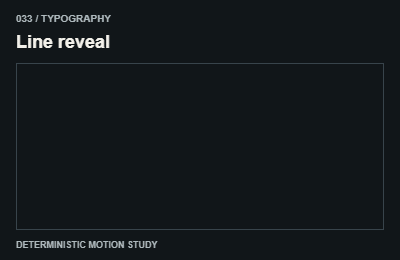
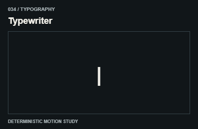
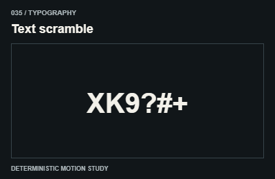
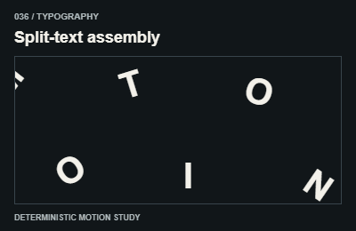
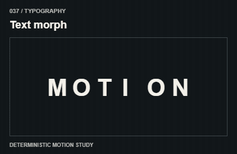
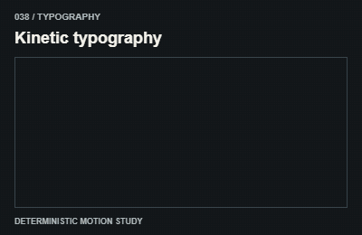
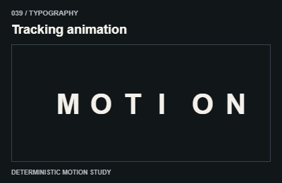
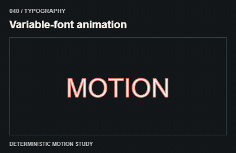

# Typography / Chữ

Preserve semantic text, grapheme clusters, Vietnamese accents and accessible reading order.

The GIFs are compact teaching studies. Keep the host application state separate from their visual timelines.

[All 240 entries](../catalog.md)

| ID / effect | GIF |
| --- | --- |
| [031 · Character stagger](031-character-stagger.md) Ký tự lệch nhịp |  |
| [032 · Word stagger](032-word-stagger.md) Từng từ nối tiếp |  |
| [033 · Line reveal](033-line-reveal.md) Từng dòng qua mask |  |
| [034 · Typewriter](034-typewriter.md) Gõ chữ |  |
| [035 · Text scramble](035-text-scramble.md) Ký tự nhiễu thành chữ |  |
| [036 · Split-text assembly](036-split-text-assembly.md) Chữ tách rồi ráp |  |
| [037 · Text morph](037-text-morph.md) Chuyển hình chữ |  |
| [038 · Kinetic typography](038-kinetic-typography.md) Chữ dẫn chuyển động |  |
| [039 · Tracking animation](039-tracking-animation.md) Đổi khoảng ký tự |  |
| [040 · Variable-font animation](040-variable-font-animation.md) Đổi trục font |  |
