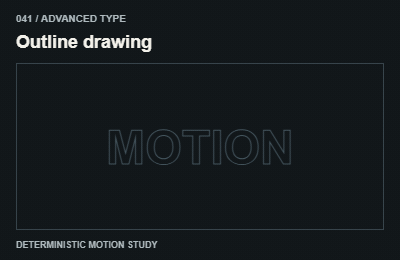
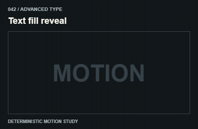
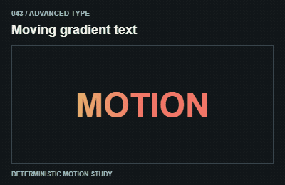
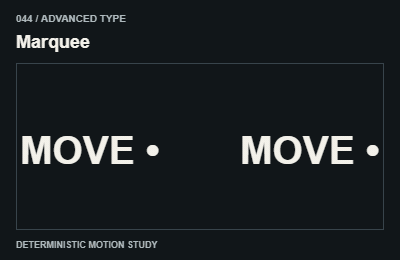
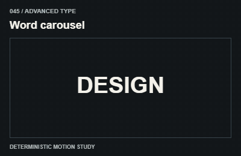
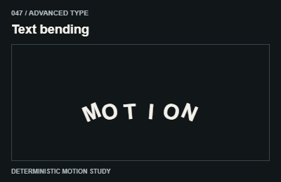
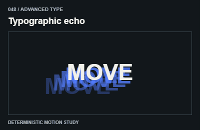
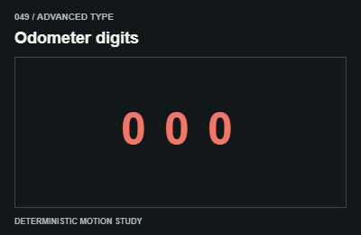

# Advanced type / Chữ nâng cao

Treat decorative duplicates as aria-hidden. Provide a static readable label beneath the visual treatment.

The GIFs are compact teaching studies. Keep the host application state separate from their visual timelines.

[All 240 entries](../catalog.md)

| ID / effect | GIF |
| --- | --- |
| [041 · Outline drawing](041-outline-drawing.md) Vẽ viền chữ |  |
| [042 · Text fill reveal](042-text-fill-reveal.md) Màu lấp vào chữ |  |
| [043 · Moving gradient text](043-moving-gradient-text.md) Gradient chạy trong chữ |  |
| [044 · Marquee](044-marquee.md) Dòng chữ chạy |  |
| [045 · Word carousel](045-word-carousel.md) Luân phiên cụm từ |  |
| [046 · Text on path](046-text-on-path.md) Chữ theo đường |  |
| [047 · Text bending](047-text-bending.md) Chữ uốn cong |  |
| [048 · Typographic echo](048-typographic-echo.md) Nhiều lớp chữ nối đuôi |  |
| [049 · Odometer digits](049-odometer-digits.md) Chữ số cuộn |  |
| [050 · Reading highlight](050-reading-highlight.md) Nhấn theo đoạn đọc |  |
