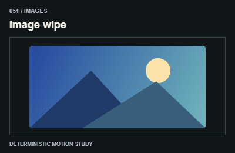
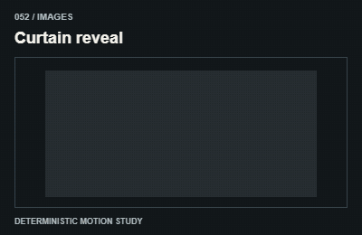
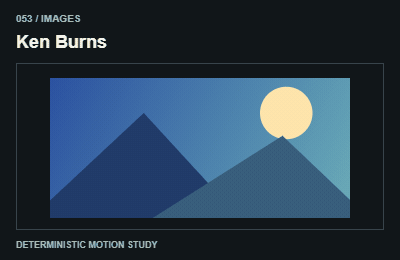
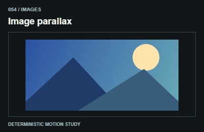
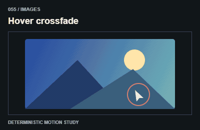
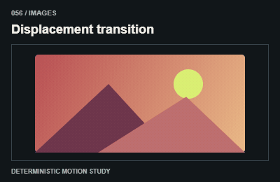
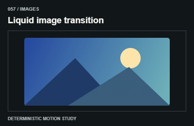
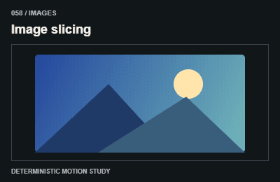
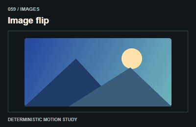
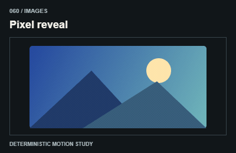

# Images / Hình ảnh

Crop inside an image wrapper. Keep aspect ratios and link hit areas fixed.

The GIFs are compact teaching studies. Keep the host application state separate from their visual timelines.

[All 240 entries](../catalog.md)

| ID / effect | GIF |
| --- | --- |
| [051 · Image wipe](051-image-wipe.md) Ảnh mở theo hướng |  |
| [052 · Curtain reveal](052-curtain-reveal.md) Mở ảnh như rèm |  |
| [053 · Ken Burns](053-ken-burns.md) Pan zoom chậm |  |
| [054 · Image parallax](054-image-parallax.md) Ảnh trôi trong khung |  |
| [055 · Hover crossfade](055-hover-crossfade.md) Đổi ảnh khi hover |  |
| [056 · Displacement transition](056-displacement-transition.md) Ảnh chuyển qua biến dạng |  |
| [057 · Liquid image transition](057-liquid-image-transition.md) Ảnh chuyển như chất lỏng |  |
| [058 · Image slicing](058-image-slicing.md) Ảnh chia thành dải |  |
| [059 · Image flip](059-image-flip.md) Lật ảnh |  |
| [060 · Pixel reveal](060-pixel-reveal.md) Ảnh hiện theo ô |  |
