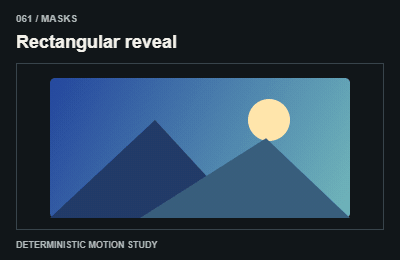
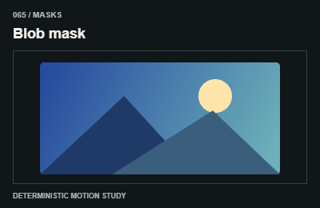
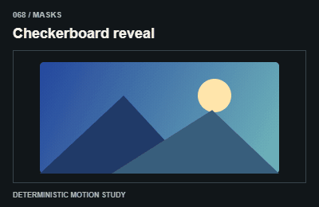
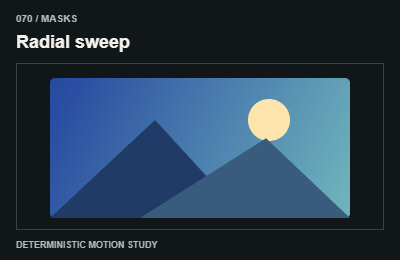

# Masks / Mask và clipping

Animate clip/mask layers, not measured scroll-trigger containers or focus outlines.

The GIFs are compact teaching studies. Keep the host application state separate from their visual timelines.

[All 240 entries](../catalog.md)

| ID / effect | GIF |
| --- | --- |
| [061 · Rectangular reveal](061-rectangular-reveal.md) Mở vùng chữ nhật |  |
| [062 · Circular reveal](062-circular-reveal.md) Mở vùng tròn |  |
| [063 · Iris transition](063-iris-transition.md) Đóng mở khẩu độ |  |
| [064 · Polygon reveal](064-polygon-reveal.md) Mở theo đa giác |  |
| [065 · Blob mask](065-blob-mask.md) Mask hữu cơ |  |
| [066 · Diagonal wipe](066-diagonal-wipe.md) Mở theo đường chéo |  |
| [067 · Venetian blinds](067-venetian-blinds.md) Mở qua các nan |  |
| [068 · Checkerboard reveal](068-checkerboard-reveal.md) Mở ô bàn cờ |  |
| [069 · Cursor-follow mask](069-cursor-follow-mask.md) Mask theo con trỏ |  |
| [070 · Radial sweep](070-radial-sweep.md) Quét góc quanh tâm |  |
