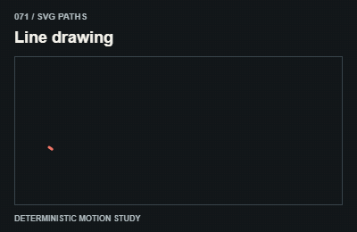

# 071 — Line drawing

Nét tự vẽ

**Category:** SVG paths · **Kind:** effect

## Implementation recipe

Set pathLength to one and animate stroke-dashoffset from one to zero.

Use normalized stroke length or compatible path topology; keep decorative paths outside reading text.

**Starting timing:** start around 850ms for a discrete transition; ongoing indicators follow real activity and stop when it ends. The 3-second teaching GIF is not a required production duration.

## Adaptation checks

End in the intended readable, interactive state. Do not retain a clipped, distorted or transparent final control.

Preserve focus, selected items and form/demo state. Respect reduced motion and stop work in hidden views.

Verify a real intermediate frame and the settled state; do not infer visible movement from a class or animation object alone.

## Demo source

[Deterministic renderer](../../assets/catalog/demo-engine.mjs): zero-based group 7, branch 0. Call `drawDemo(context, 71, normalizedTime)` on a 400 × 260 Canvas. The full source is study material; port only the selected mechanism into production.

[Group GIFs](08-svg-paths.md) · [Catalog index](../catalog.md) · [Reliability](../reliability.md)
