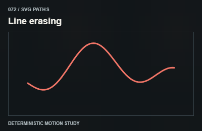
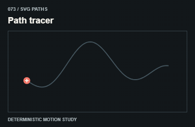
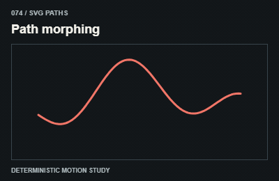
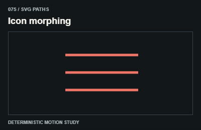
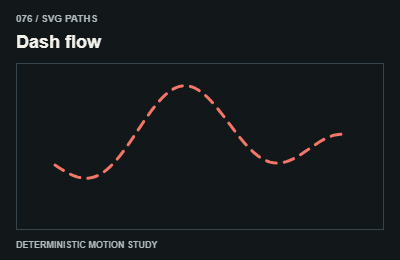
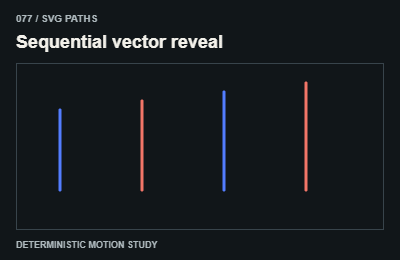
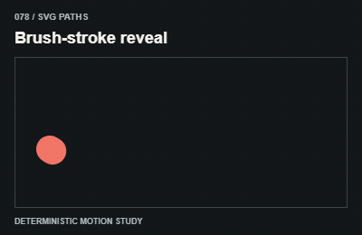
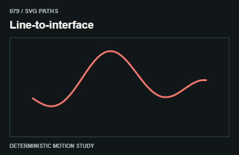
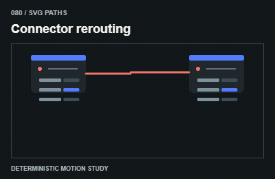

# SVG paths / SVG và nét vẽ

Use normalized stroke length or compatible path topology; keep decorative paths outside reading text.

The GIFs are compact teaching studies. Keep the host application state separate from their visual timelines.

[All 240 entries](../catalog.md)

| ID / effect | GIF |
| --- | --- |
| [071 · Line drawing](071-line-drawing.md) Nét tự vẽ |  |
| [072 · Line erasing](072-line-erasing.md) Nét tự xóa |  |
| [073 · Path tracer](073-path-tracer.md) Điểm sáng theo nét |  |
| [074 · Path morphing](074-path-morphing.md) Đường biến hình |  |
| [075 · Icon morphing](075-icon-morphing.md) Icon biến hình |  |
| [076 · Dash flow](076-dash-flow.md) Nét đứt chạy |  |
| [077 · Sequential vector reveal](077-sequential-vector-reveal.md) Các phần SVG nối tiếp |  |
| [078 · Brush-stroke reveal](078-brush-stroke-reveal.md) Nét cọ mở nội dung |  |
| [079 · Line-to-interface](079-line-to-interface.md) Nét thành giao diện |  |
| [080 · Connector rerouting](080-connector-rerouting.md) Đường nối đổi tuyến |  |
