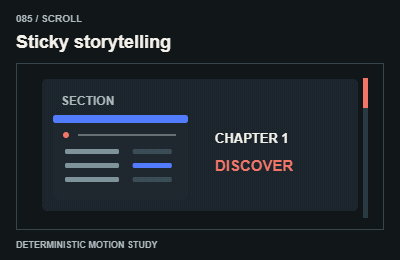

# 085 — Sticky storytelling

Kể chuyện trong sticky

**Category:** Scroll · **Kind:** effect

## Implementation recipe

Change the visual chapter while readable sections move beside a fixed stage.

Use native scrolling, stable measurements and bounded progress; do not hijack wheel or touch.

**Starting timing:** map actual scroll, pointer or drag progress to the visual range; use a short bounded follower only when needed. No fixed autoplay duration is required.

## Adaptation checks

End in the intended readable, interactive state. Do not retain a clipped, distorted or transparent final control.

Preserve focus, selected items and form/demo state. Respect reduced motion and stop work in hidden views.

Verify a real intermediate frame and the settled state; do not infer visible movement from a class or animation object alone.

## Demo source

[Deterministic renderer](../../assets/catalog/demo-engine.mjs): zero-based group 8, branch 4. Call `drawDemo(context, 85, normalizedTime)` on a 400 × 260 Canvas. The full source is study material; port only the selected mechanism into production.

[Group GIFs](09-scroll.md) · [Catalog index](../catalog.md) · [Reliability](../reliability.md)
