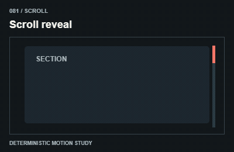
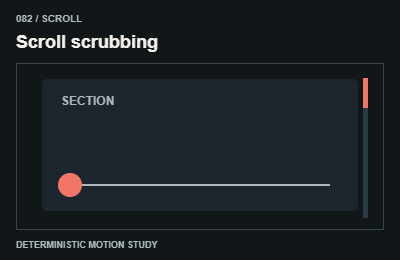
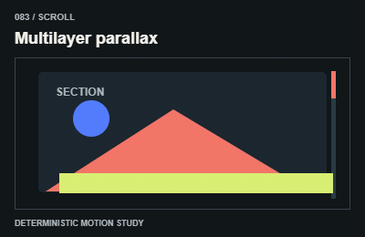
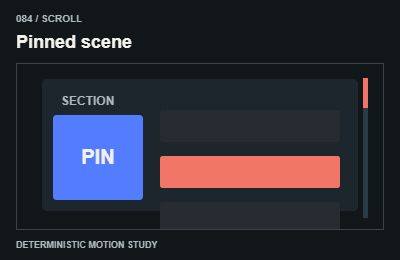
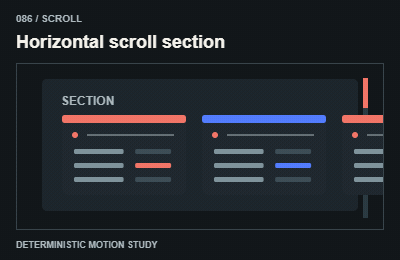
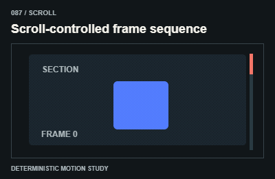
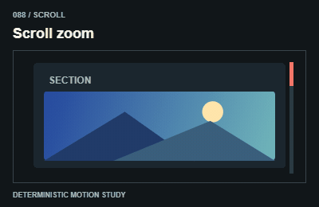
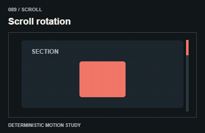

# Scroll / Theo cuộn

Use native scrolling, stable measurements and bounded progress; do not hijack wheel or touch.

The GIFs are compact teaching studies. Keep the host application state separate from their visual timelines.

[All 240 entries](../catalog.md)

| ID / effect | GIF |
| --- | --- |
| [081 · Scroll reveal](081-scroll-reveal.md) Hiện khi cuộn tới |  |
| [082 · Scroll scrubbing](082-scroll-scrubbing.md) Tiến trình bám cuộn |  |
| [083 · Multilayer parallax](083-multilayer-parallax.md) Nhiều lớp trôi |  |
| [084 · Pinned scene](084-pinned-scene.md) Ghim một cảnh |  |
| [085 · Sticky storytelling](085-sticky-storytelling.md) Kể chuyện trong sticky |  |
| [086 · Horizontal scroll section](086-horizontal-scroll-section.md) Cuộn dọc thành dải ngang |  |
| [087 · Scroll-controlled frame sequence](087-scroll-controlled-frame-sequence.md) Cuộn điều khiển khung hình |  |
| [088 · Scroll zoom](088-scroll-zoom.md) Cuộn để tiến gần |  |
| [089 · Scroll rotation](089-scroll-rotation.md) Cuộn đổi góc |  |
| [090 · Reading progression](090-reading-progression.md) Tiến trình đọc |  |
