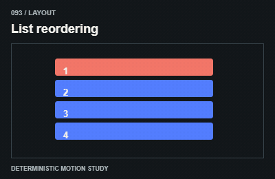

# 093 — List reordering

Danh sách đổi thứ tự

**Category:** Layout · **Kind:** effect

## Implementation recipe

Animate keyed row deltas when sorting changes their layout.

Measure before/after layout once; animate visual deltas without changing DOM identity or app data.

**Starting timing:** start around 240–500ms for layout changes; measure once, support interruption and preserve element identity.

## Adaptation checks

End in the intended readable, interactive state. Do not retain a clipped, distorted or transparent final control.

Preserve focus, selected items and form/demo state. Respect reduced motion and stop work in hidden views.

Verify a real intermediate frame and the settled state; do not infer visible movement from a class or animation object alone.

## Demo source

[Deterministic renderer](../../assets/catalog/demo-engine.mjs): zero-based group 9, branch 2. Call `drawDemo(context, 93, normalizedTime)` on a 400 × 260 Canvas. The full source is study material; port only the selected mechanism into production.

[Group GIFs](10-layout.md) · [Catalog index](../catalog.md) · [Reliability](../reliability.md)
