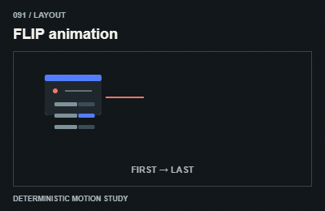
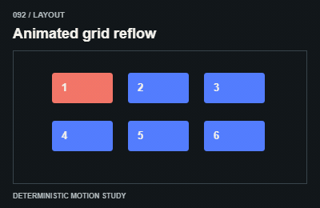
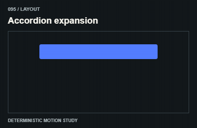
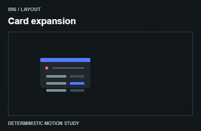
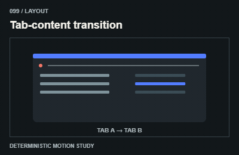
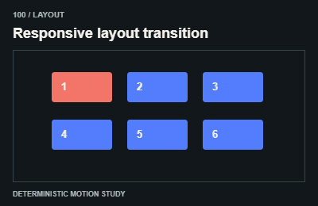

# Layout / Bố cục

Measure before/after layout once; animate visual deltas without changing DOM identity or app data.

The GIFs are compact teaching studies. Keep the host application state separate from their visual timelines.

[All 240 entries](../catalog.md)

| ID / effect | GIF |
| --- | --- |
| [091 · FLIP animation](091-flip-animation.md) Nối hai layout |  |
| [092 · Animated grid reflow](092-animated-grid-reflow.md) Lưới chuyển vị trí |  |
| [093 · List reordering](093-list-reordering.md) Danh sách đổi thứ tự |  |
| [094 · Masonry rearrangement](094-masonry-rearrangement.md) Khối lệch hàng tổ chức lại |  |
| [095 · Accordion expansion](095-accordion-expansion.md) Mở chiều cao |  |
| [096 · Card expansion](096-card-expansion.md) Thẻ mở rộng |  |
| [097 · Shape interpolation](097-shape-interpolation.md) Khung đổi hình |  |
| [098 · Sliding navigation indicator](098-sliding-navigation-indicator.md) Chỉ báo trượt |  |
| [099 · Tab-content transition](099-tab-content-transition.md) Đổi nội dung tab |  |
| [100 · Responsive layout transition](100-responsive-layout-transition.md) Chuyển bố cục responsive |  |
