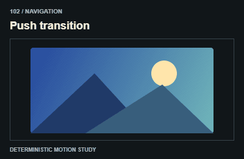
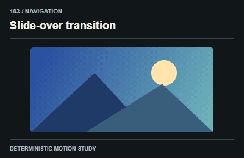
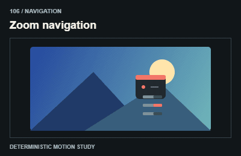
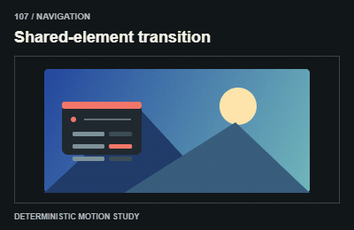

# Navigation / Chuyển trang

Preserve navigation semantics and focus; clean up overlays and handle interrupted navigation.

The GIFs are compact teaching studies. Keep the host application state separate from their visual timelines.

[All 240 entries](../catalog.md)

| ID / effect | GIF |
| --- | --- |
| [101 · Page crossfade](101-page-crossfade.md) Hai trang hòa nhau |  |
| [102 · Push transition](102-push-transition.md) Trang mới đẩy cũ |  |
| [103 · Slide-over transition](103-slide-over-transition.md) Trang phủ trượt |  |
| [104 · Page curtain](104-page-curtain.md) Rèm chuyển trang |  |
| [105 · Portal transition](105-portal-transition.md) Qua khung sang cảnh |  |
| [106 · Zoom navigation](106-zoom-navigation.md) Phóng vào điểm đến |  |
| [107 · Shared-element transition](107-shared-element-transition.md) Phần tử nối hai trang |  |
| [108 · Glitch transition](108-glitch-transition.md) Nhiễu lúc chuyển |  |
| [109 · Paper-tear transition](109-paper-tear-transition.md) Xé giấy lộ trang |  |
| [110 · Diagonal scene cut](110-diagonal-scene-cut.md) Cắt cảnh theo mảng chéo |  |
