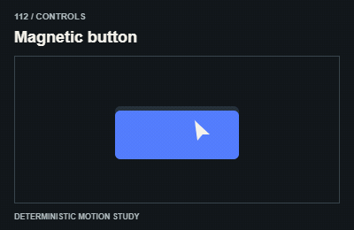

# 112 — Magnetic button

Nút hút nhẹ

**Category:** Controls · **Kind:** effect

## Implementation recipe

Offset an inner visual toward the pointer while retaining the actual hit box.

An interaction must work immediately. Animation should confirm the action, not delay it.

**Starting timing:** start around 120–240ms for interaction feedback; the action and focus response must work immediately.

## Adaptation checks

End in the intended readable, interactive state. Do not retain a clipped, distorted or transparent final control.

Preserve focus, selected items and form/demo state. Respect reduced motion and stop work in hidden views.

Verify a real intermediate frame and the settled state; do not infer visible movement from a class or animation object alone.

## Demo source

[Deterministic renderer](../../assets/catalog/demo-engine.mjs): zero-based group 11, branch 1. Call `drawDemo(context, 112, normalizedTime)` on a 400 × 260 Canvas. The full source is study material; port only the selected mechanism into production.

[Group GIFs](12-controls.md) · [Catalog index](../catalog.md) · [Reliability](../reliability.md)
