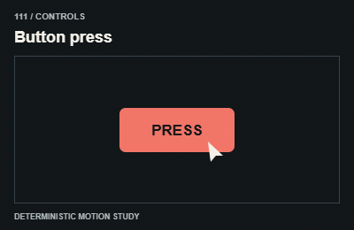
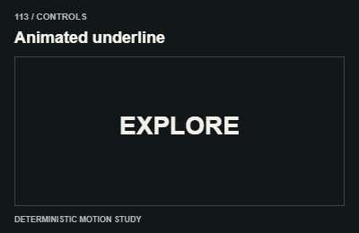
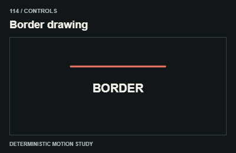
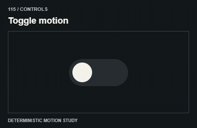
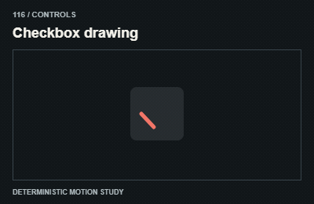
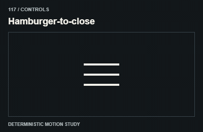
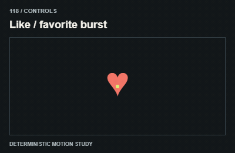
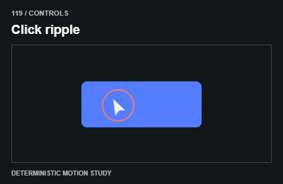
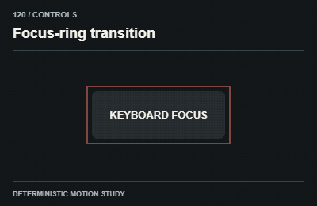

# Controls / Điều khiển

An interaction must work immediately. Animation should confirm the action, not delay it.

The GIFs are compact teaching studies. Keep the host application state separate from their visual timelines.

[All 240 entries](../catalog.md)

| ID / effect | GIF |
| --- | --- |
| [111 · Button press](111-button-press.md) Nút nén khi bấm |  |
| [112 · Magnetic button](112-magnetic-button.md) Nút hút nhẹ |  |
| [113 · Animated underline](113-animated-underline.md) Gạch chân chuyển động |  |
| [114 · Border drawing](114-border-drawing.md) Vẽ đường viền |  |
| [115 · Toggle motion](115-toggle-motion.md) Công tắc đổi trạng thái |  |
| [116 · Checkbox drawing](116-checkbox-drawing.md) Vẽ dấu tích |  |
| [117 · Hamburger-to-close](117-hamburger-to-close.md) Menu thành dấu đóng |  |
| [118 · Like / favorite burst](118-like-favorite-burst.md) Yêu thích bật phản hồi |  |
| [119 · Click ripple](119-click-ripple.md) Gợn từ điểm bấm |  |
| [120 · Focus-ring transition](120-focus-ring-transition.md) Viền focus đổi trạng thái |  |
