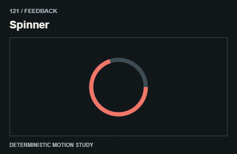
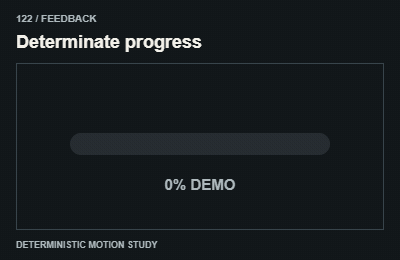
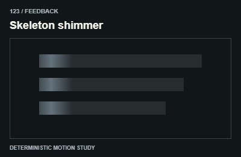
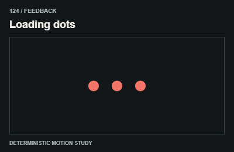
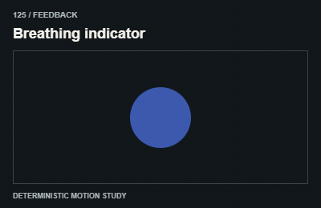
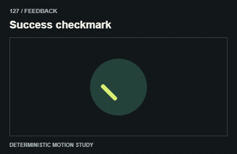
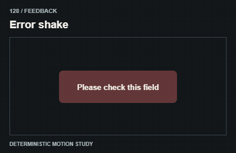
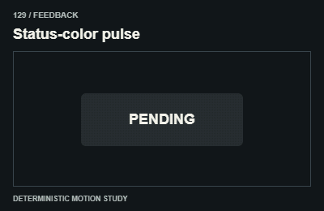
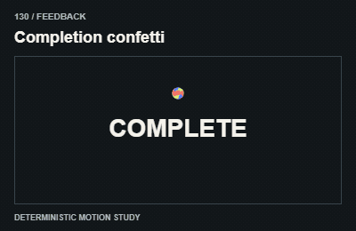

# Feedback / Loading và trạng thái

Only show actual loading/progress or an explicitly labeled illustration; never fake success.

The GIFs are compact teaching studies. Keep the host application state separate from their visual timelines.

[All 240 entries](../catalog.md)

| ID / effect | GIF |
| --- | --- |
| [121 · Spinner](121-spinner.md) Vòng đang xử lý |  |
| [122 · Determinate progress](122-determinate-progress.md) Tiến trình có dữ liệu |  |
| [123 · Skeleton shimmer](123-skeleton-shimmer.md) Vệt sáng trên khung chờ |  |
| [124 · Loading dots](124-loading-dots.md) Chấm chờ nối tiếp |  |
| [125 · Breathing indicator](125-breathing-indicator.md) Chỉ báo nhịp thở |  |
| [126 · Stroke loader](126-stroke-loader.md) Nét chạy quanh đường |  |
| [127 · Success checkmark](127-success-checkmark.md) Dấu hoàn tất |  |
| [128 · Error shake](128-error-shake.md) Rung báo lỗi |  |
| [129 · Status-color pulse](129-status-color-pulse.md) Nhấn màu trạng thái |  |
| [130 · Completion confetti](130-completion-confetti.md) Giấy mừng hoàn thành |  |
