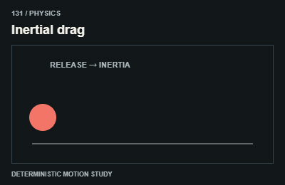
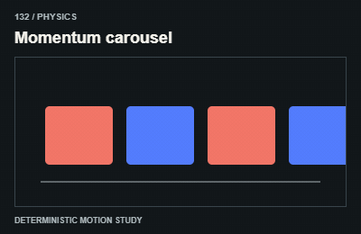
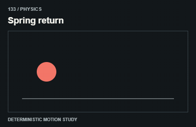
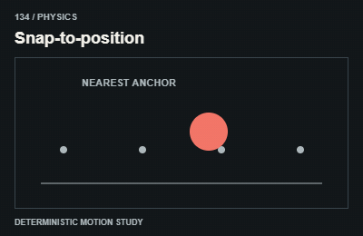
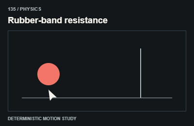
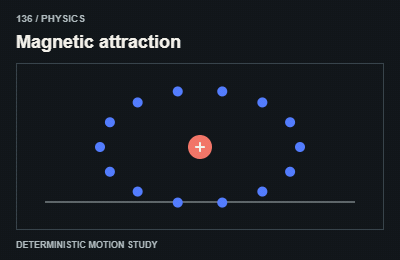
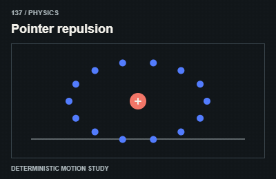
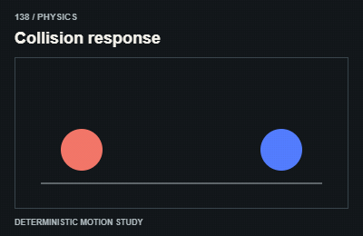
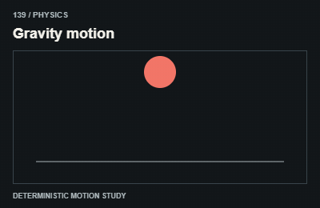
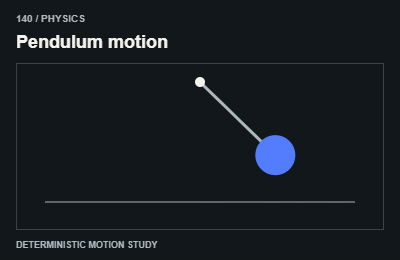

# Physics / Vật lý và kéo

Keep physics bounded and deterministic enough to settle; preserve keyboard alternatives.

The GIFs are compact teaching studies. Keep the host application state separate from their visual timelines.

[All 240 entries](../catalog.md)

| ID / effect | GIF |
| --- | --- |
| [131 · Inertial drag](131-inertial-drag.md) Kéo có quán tính |  |
| [132 · Momentum carousel](132-momentum-carousel.md) Carousel giữ đà |  |
| [133 · Spring return](133-spring-return.md) Lò xo về vị trí |  |
| [134 · Snap-to-position](134-snap-to-position.md) Hút về điểm neo |  |
| [135 · Rubber-band resistance](135-rubber-band-resistance.md) Kéo vượt có lực cản |  |
| [136 · Magnetic attraction](136-magnetic-attraction.md) Vật hút nhau |  |
| [137 · Pointer repulsion](137-pointer-repulsion.md) Vật tránh con trỏ |  |
| [138 · Collision response](138-collision-response.md) Phản ứng va chạm |  |
| [139 · Gravity motion](139-gravity-motion.md) Chuyển động trọng lực |  |
| [140 · Pendulum motion](140-pendulum-motion.md) Đung đưa |  |
