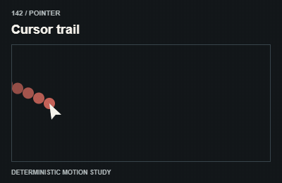
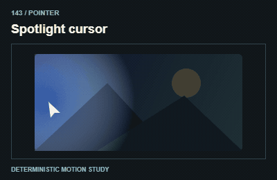
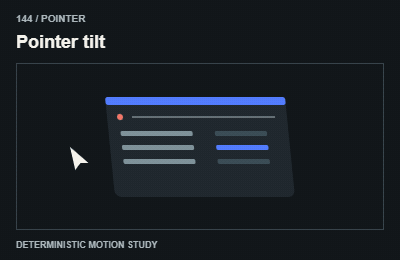
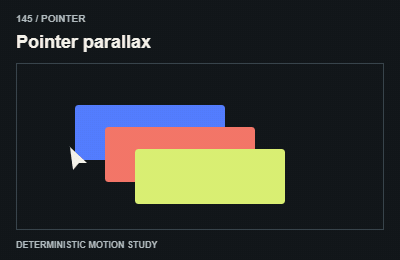
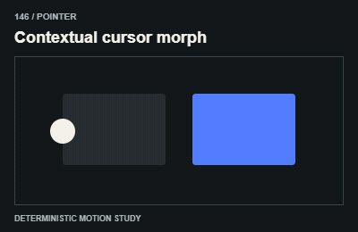
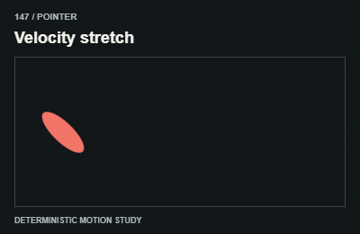
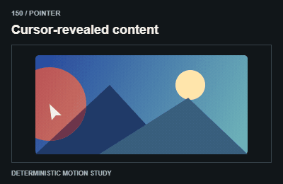

# Pointer / Con trỏ

Provide touch/keyboard equivalents and avoid moving a hit target away from the pointer.

The GIFs are compact teaching studies. Keep the host application state separate from their visual timelines.

[All 240 entries](../catalog.md)

| ID / effect | GIF |
| --- | --- |
| [141 · Cursor follower](141-cursor-follower.md) Lớp theo chuột |  |
| [142 · Cursor trail](142-cursor-trail.md) Đuôi con trỏ |  |
| [143 · Spotlight cursor](143-spotlight-cursor.md) Vùng sáng theo chuột |  |
| [144 · Pointer tilt](144-pointer-tilt.md) Mặt nghiêng theo chuột |  |
| [145 · Pointer parallax](145-pointer-parallax.md) Các lớp lệch theo chuột |  |
| [146 · Contextual cursor morph](146-contextual-cursor-morph.md) Con trỏ đổi ngữ cảnh |  |
| [147 · Velocity stretch](147-velocity-stretch.md) Kéo dài theo tốc độ |  |
| [148 · Brush painting](148-brush-painting.md) Chuột vẽ bề mặt |  |
| [149 · Particle cursor](149-particle-cursor.md) Hạt theo con trỏ |  |
| [150 · Cursor-revealed content](150-cursor-revealed-content.md) Chuột lộ nội dung |  |
