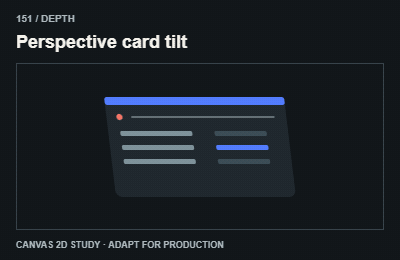

# 151 — Perspective card tilt

Thẻ nghiêng phối cảnh

**Category:** Depth · **Kind:** effect

## Implementation recipe

Rotate a card around X and Y with a limited perspective depth.

Use perspective, transforms or a real 3D renderer as appropriate. Canvas GIFs are 2D projection studies.

**Starting timing:** start around 850ms for a discrete transition; ongoing indicators follow real activity and stop when it ends. The 3-second teaching GIF is not a required production duration.

## Adaptation checks

End in the intended readable, interactive state. Do not retain a clipped, distorted or transparent final control.

This preview is a Canvas 2D approximation of the visual principle. For true 3D, shaders or physical material behavior, build the appropriate renderer and verify depth, interaction and performance separately.

Verify a real intermediate frame and the settled state; do not infer visible movement from a class or animation object alone.

## Demo source

[Deterministic renderer](../../assets/catalog/demo-engine.mjs): zero-based group 15, branch 0. Call `drawDemo(context, 151, normalizedTime)` on a 400 × 260 Canvas. The full source is study material; port only the selected mechanism into production.

[Group GIFs](16-depth.md) · [Catalog index](../catalog.md) · [Reliability](../reliability.md)
