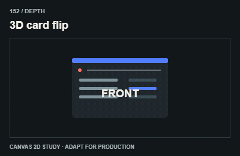
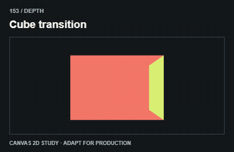
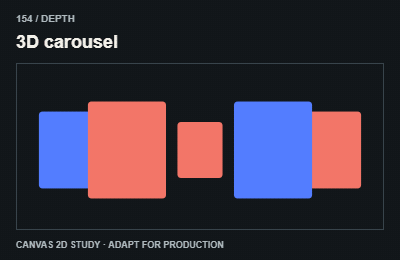
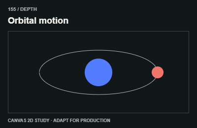
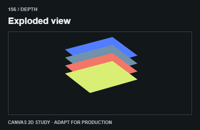
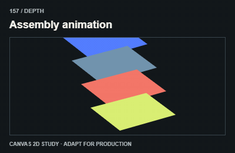
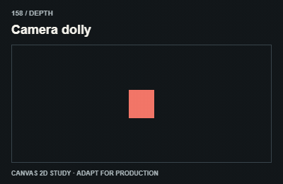
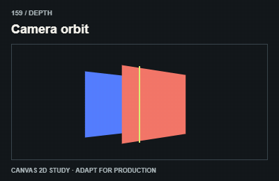
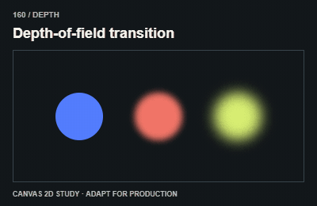

# Depth / 3D và chiều sâu

Use perspective, transforms or a real 3D renderer as appropriate. Canvas GIFs are 2D projection studies.

The GIFs are compact teaching studies. Keep the host application state separate from their visual timelines.

[All 240 entries](../catalog.md)

| ID / effect | GIF |
| --- | --- |
| [151 · Perspective card tilt](151-perspective-card-tilt.md) Thẻ nghiêng phối cảnh |  |
| [152 · 3D card flip](152-3d-card-flip.md) Lật thẻ 3D |  |
| [153 · Cube transition](153-cube-transition.md) Chuyển mặt khối hộp |  |
| [154 · 3D carousel](154-3d-carousel.md) Carousel không gian |  |
| [155 · Orbital motion](155-orbital-motion.md) Vật đi quanh tâm |  |
| [156 · Exploded view](156-exploded-view.md) Sản phẩm tách lớp |  |
| [157 · Assembly animation](157-assembly-animation.md) Các bộ phận ráp lại |  |
| [158 · Camera dolly](158-camera-dolly.md) Camera tiến lùi |  |
| [159 · Camera orbit](159-camera-orbit.md) Camera xoay quanh vật |  |
| [160 · Depth-of-field transition](160-depth-of-field-transition.md) Đổi nét theo chiều sâu |  |
