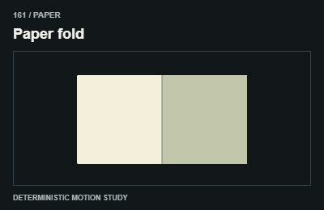
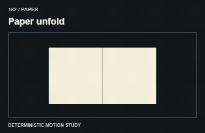
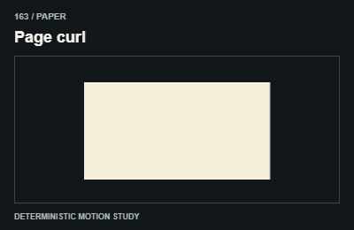
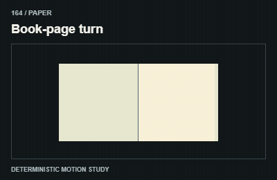
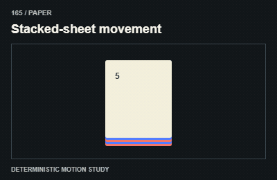
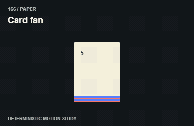
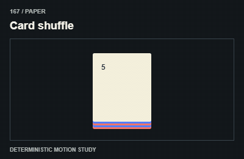
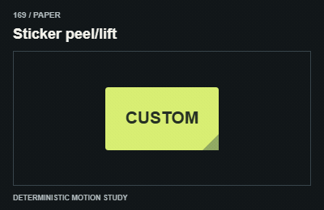
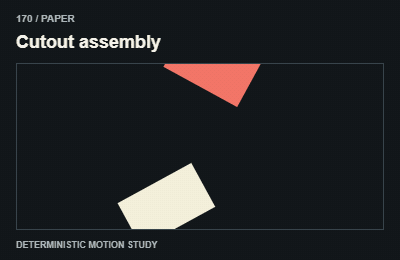

# Paper / Giấy và vật liệu

Restrict rotations/folds to artwork; real paragraphs, forms and controls remain upright.

The GIFs are compact teaching studies. Keep the host application state separate from their visual timelines.

[All 240 entries](../catalog.md)

| ID / effect | GIF |
| --- | --- |
| [161 · Paper fold](161-paper-fold.md) Gấp giấy |  |
| [162 · Paper unfold](162-paper-unfold.md) Mở lớp gấp |  |
| [163 · Page curl](163-page-curl.md) Cuộn mép trang |  |
| [164 · Book-page turn](164-book-page-turn.md) Lật trang sách |  |
| [165 · Stacked-sheet movement](165-stacked-sheet-movement.md) Chồng giấy dịch chuyển |  |
| [166 · Card fan](166-card-fan.md) Xòe thẻ |  |
| [167 · Card shuffle](167-card-shuffle.md) Xáo thẻ |  |
| [168 · Folder opening](168-folder-opening.md) Mở tập hồ sơ |  |
| [169 · Sticker peel/lift](169-sticker-peel-lift.md) Nhấc nhãn dán |  |
| [170 · Cutout assembly](170-cutout-assembly.md) Ghép mảnh cắt |  |
