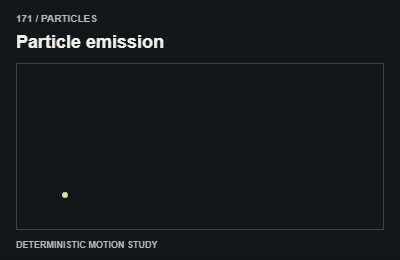
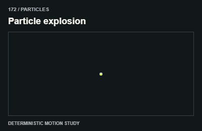
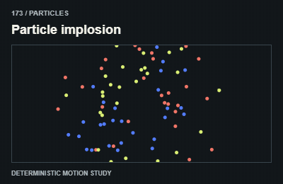
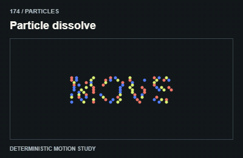
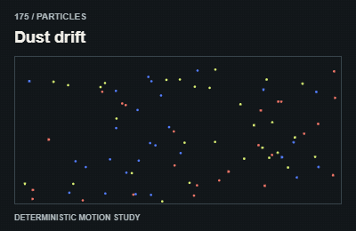
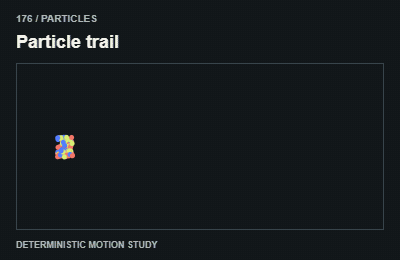
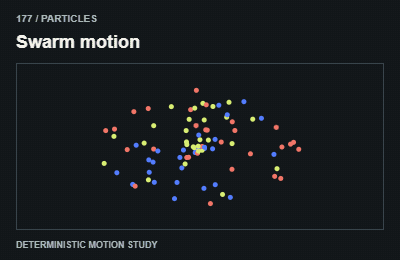
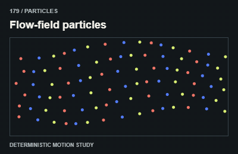

# Particles / Hạt

Use bounded particle counts and deterministic seeds for testing. Keep decorative canvases out of the accessibility tree.

The GIFs are compact teaching studies. Keep the host application state separate from their visual timelines.

[All 240 entries](../catalog.md)

| ID / effect | GIF |
| --- | --- |
| [171 · Particle emission](171-particle-emission.md) Phát hạt |  |
| [172 · Particle explosion](172-particle-explosion.md) Hạt bung ra |  |
| [173 · Particle implosion](173-particle-implosion.md) Hạt hút vào |  |
| [174 · Particle dissolve](174-particle-dissolve.md) Nội dung tan thành hạt |  |
| [175 · Dust drift](175-dust-drift.md) Bụi trôi |  |
| [176 · Particle trail](176-particle-trail.md) Đường đuôi hạt |  |
| [177 · Swarm motion](177-swarm-motion.md) Bầy hạt thành cụm |  |
| [178 · Flocking](178-flocking.md) Bầy đàn |  |
| [179 · Flow-field particles](179-flow-field-particles.md) Hạt theo trường hướng |  |
| [180 · Particle text formation](180-particle-text-formation.md) Hạt tụ thành chữ |  |
