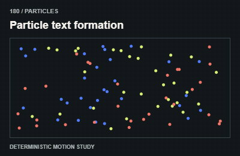

# 180 — Particle text formation

Hạt tụ thành chữ

**Category:** Particles · **Kind:** effect

## Implementation recipe

Assign particles to sampled text target positions.

Use bounded particle counts and deterministic seeds for testing. Keep decorative canvases out of the accessibility tree.

**Starting timing:** use a bounded simulation loop while visible, with a finite end or explicit pause policy; do not run decorative particle work in hidden views.

## Adaptation checks

End in the intended readable, interactive state. Do not retain a clipped, distorted or transparent final control.

Preserve focus, selected items and form/demo state. Respect reduced motion and stop work in hidden views.

Verify a real intermediate frame and the settled state; do not infer visible movement from a class or animation object alone.

## Demo source

[Deterministic renderer](../../assets/catalog/demo-engine.mjs): zero-based group 17, branch 9. Call `drawDemo(context, 180, normalizedTime)` on a 400 × 260 Canvas. The full source is study material; port only the selected mechanism into production.

[Group GIFs](18-particles.md) · [Catalog index](../catalog.md) · [Reliability](../reliability.md)
