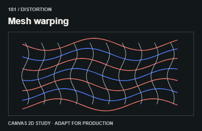
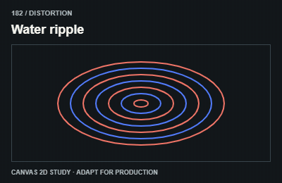
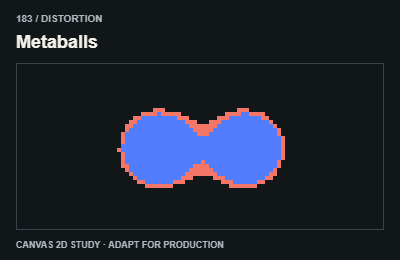
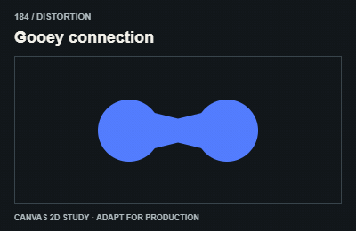
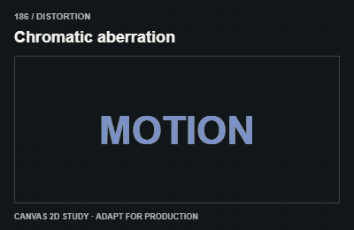
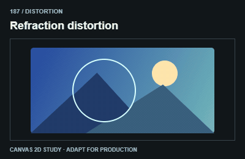
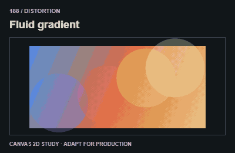
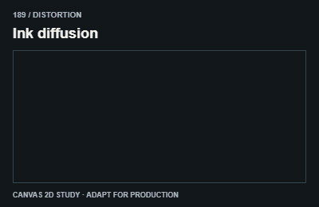
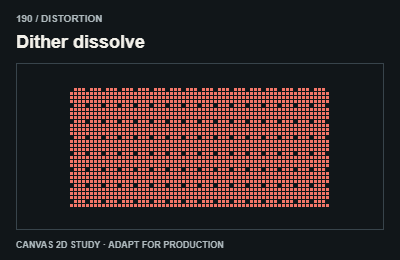

# Distortion / Shader và biến dạng

These GIFs are Canvas 2D studies. Use shaders, mesh rendering or compositing when actual production fidelity needs them.

The GIFs are compact teaching studies. Keep the host application state separate from their visual timelines.

[All 240 entries](../catalog.md)

| ID / effect | GIF |
| --- | --- |
| [181 · Mesh warping](181-mesh-warping.md) Uốn bề mặt lưới |  |
| [182 · Water ripple](182-water-ripple.md) Gợn nước |  |
| [183 · Metaballs](183-metaballs.md) Khối hữu cơ nhập tách |  |
| [184 · Gooey connection](184-gooey-connection.md) Nối như chất keo |  |
| [185 · Noise displacement](185-noise-displacement.md) Méo theo nhiễu |  |
| [186 · Chromatic aberration](186-chromatic-aberration.md) Tách kênh màu |  |
| [187 · Refraction distortion](187-refraction-distortion.md) Méo khúc xạ |  |
| [188 · Fluid gradient](188-fluid-gradient.md) Màu như chất lỏng |  |
| [189 · Ink diffusion](189-ink-diffusion.md) Mực loang |  |
| [190 · Dither dissolve](190-dither-dissolve.md) Tan theo mẫu điểm |  |
