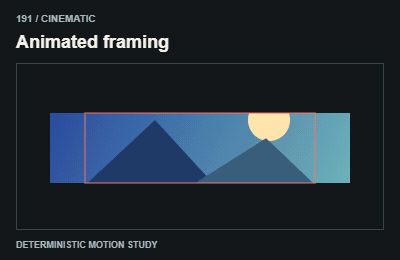
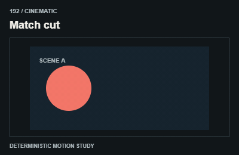
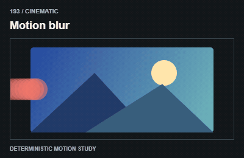
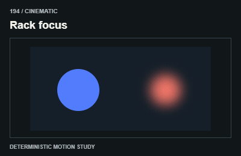
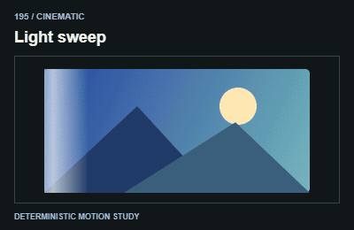
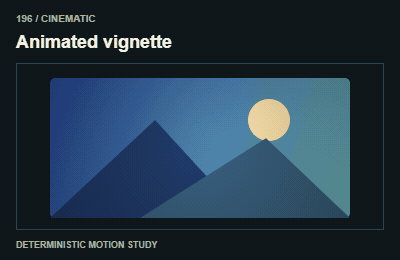
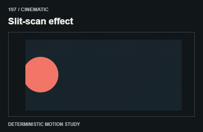
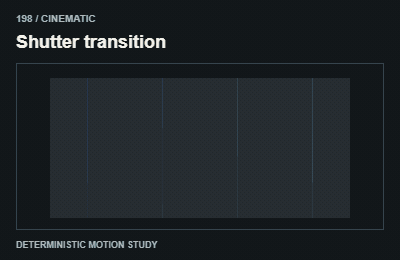
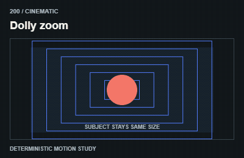

# Cinematic / Điện ảnh

Let framing, focus or lighting serve a concrete transition. Avoid invented playback controls and telemetry.

The GIFs are compact teaching studies. Keep the host application state separate from their visual timelines.

[All 240 entries](../catalog.md)

| ID / effect | GIF |
| --- | --- |
| [191 · Animated framing](191-animated-framing.md) Khung thay đổi |  |
| [192 · Match cut](192-match-cut.md) Nối cảnh tương ứng |  |
| [193 · Motion blur](193-motion-blur.md) Nhòe chuyển động |  |
| [194 · Rack focus](194-rack-focus.md) Chuyển điểm nét |  |
| [195 · Light sweep](195-light-sweep.md) Vệt sáng quét |  |
| [196 · Animated vignette](196-animated-vignette.md) Viền tối thay đổi |  |
| [197 · Slit-scan effect](197-slit-scan-effect.md) Lát thời gian |  |
| [198 · Shutter transition](198-shutter-transition.md) Đóng mở cửa chớp |  |
| [199 · Letterbox transition](199-letterbox-transition.md) Dải điện ảnh đóng mở |  |
| [200 · Dolly zoom](200-dolly-zoom.md) Zoom phối hợp camera |  |
