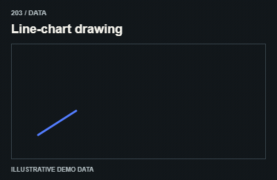

# 203 — Line-chart drawing

Vẽ biểu đồ đường

**Category:** Data · **Kind:** effect

## Implementation recipe

Reveal the actual data path with a normalized stroke window.

Derive values from actual data. GIF values are labeled demo; provide readable data alternatives in production.

**Starting timing:** start around 850ms for a discrete transition; ongoing indicators follow real activity and stop when it ends. The 3-second teaching GIF is not a required production duration.

## Adaptation checks

End in the intended readable, interactive state. Do not retain a clipped, distorted or transparent final control.

Preserve focus, selected items and form/demo state. Respect reduced motion and stop work in hidden views.

Verify a real intermediate frame and the settled state; do not infer visible movement from a class or animation object alone.

## Demo source

[Deterministic renderer](../../assets/catalog/demo-engine.mjs): zero-based group 20, branch 2. Call `drawDemo(context, 203, normalizedTime)` on a 400 × 260 Canvas. The full source is study material; port only the selected mechanism into production.

[Group GIFs](21-data.md) · [Catalog index](../catalog.md) · [Reliability](../reliability.md)
