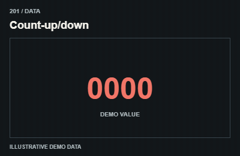
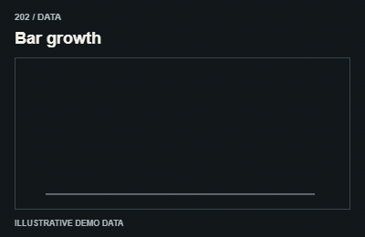
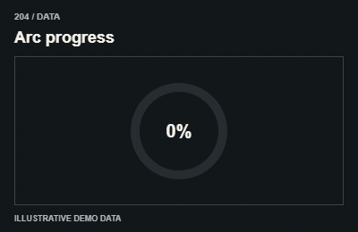
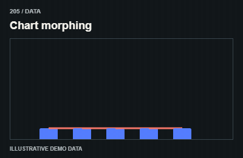
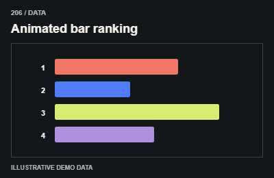
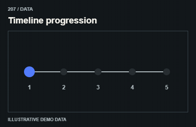
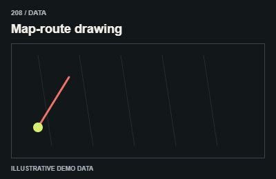
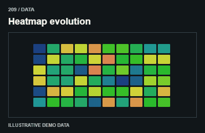
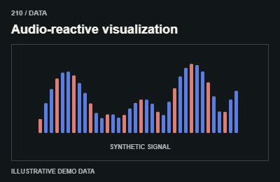

# Data / Dữ liệu

Derive values from actual data. GIF values are labeled demo; provide readable data alternatives in production.

The GIFs are compact teaching studies. Keep the host application state separate from their visual timelines.

[All 240 entries](../catalog.md)

| ID / effect | GIF |
| --- | --- |
| [201 · Count-up/down](201-count-up-down.md) Số đổi giá trị |  |
| [202 · Bar growth](202-bar-growth.md) Cột phát triển |  |
| [203 · Line-chart drawing](203-line-chart-drawing.md) Vẽ biểu đồ đường |  |
| [204 · Arc progress](204-arc-progress.md) Tiến trình cung |  |
| [205 · Chart morphing](205-chart-morphing.md) Đổi cấu trúc biểu đồ |  |
| [206 · Animated bar ranking](206-animated-bar-ranking.md) Đổi thứ hạng |  |
| [207 · Timeline progression](207-timeline-progression.md) Tiến qua mốc |  |
| [208 · Map-route drawing](208-map-route-drawing.md) Vẽ tuyến bản đồ |  |
| [209 · Heatmap evolution](209-heatmap-evolution.md) Bản đồ nhiệt đổi |  |
| [210 · Audio-reactive visualization](210-audio-reactive-visualization.md) Phản ứng âm thanh |  |
