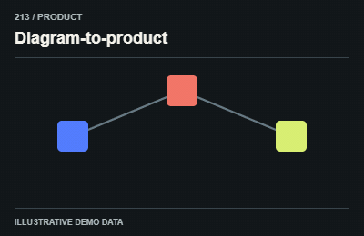
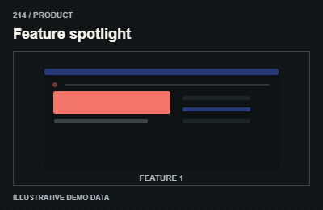
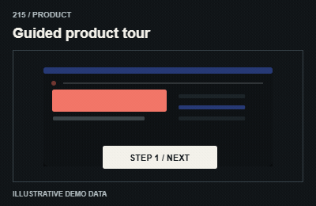
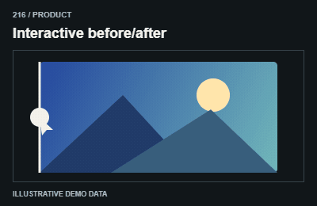
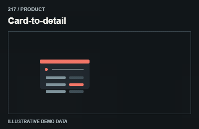
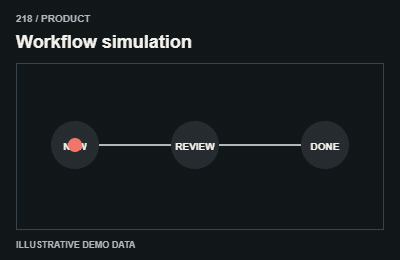
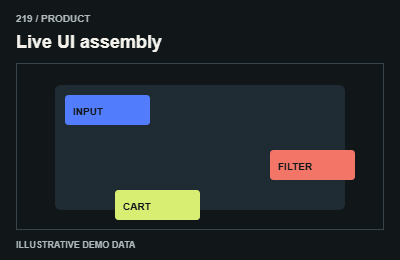
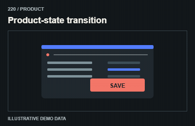

# Product / Sản phẩm và ứng dụng

Use real app elements when the design calls for live UI; presentation must never mutate business state.

The GIFs are compact teaching studies. Keep the host application state separate from their visual timelines.

[All 240 entries](../catalog.md)

| ID / effect | GIF |
| --- | --- |
| [211 · Task-to-dashboard](211-task-to-dashboard.md) Tác vụ thành dashboard |  |
| [212 · Wireframe-to-interface](212-wireframe-to-interface.md) Khung thành UI |  |
| [213 · Diagram-to-product](213-diagram-to-product.md) Sơ đồ thành sản phẩm |  |
| [214 · Feature spotlight](214-feature-spotlight.md) Nhấn tính năng |  |
| [215 · Guided product tour](215-guided-product-tour.md) Hướng dẫn từng điểm |  |
| [216 · Interactive before/after](216-interactive-before-after.md) So sánh trước sau |  |
| [217 · Card-to-detail](217-card-to-detail.md) Thẻ thành chi tiết |  |
| [218 · Workflow simulation](218-workflow-simulation.md) Mô phỏng quy trình |  |
| [219 · Live UI assembly](219-live-ui-assembly.md) UI thật ráp lại |  |
| [220 · Product-state transition](220-product-state-transition.md) Đổi trạng thái sản phẩm |  |
