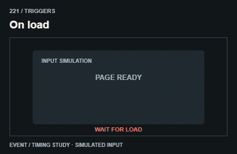
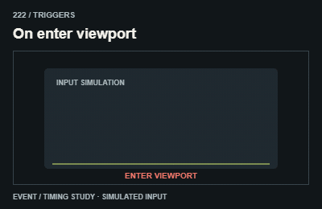
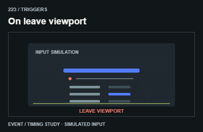
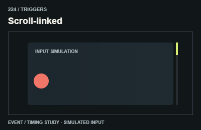
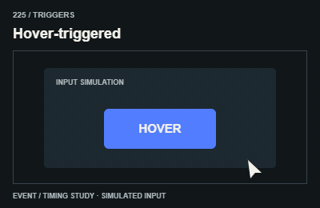
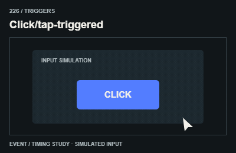
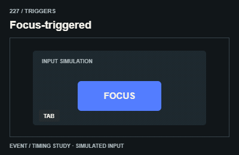
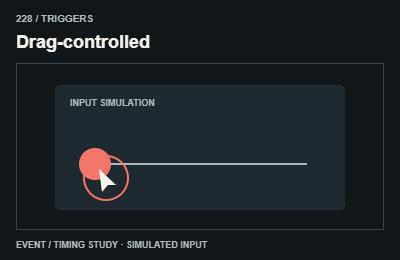
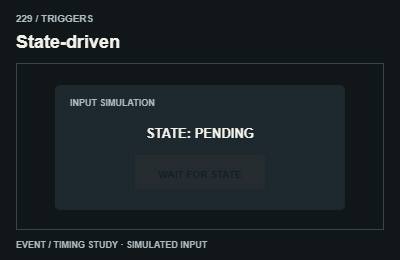
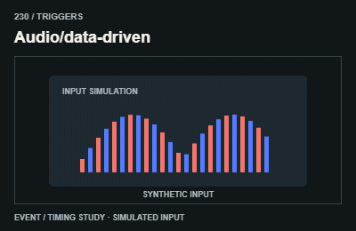

# Triggers / Cách kích hoạt

The GIF simulates an input event; it cannot receive hover, focus or scroll. Implement the actual event in the host app.

The GIFs are compact teaching studies. Keep the host application state separate from their visual timelines.

[All 240 entries](../catalog.md)

| ID / effect | GIF |
| --- | --- |
| [221 · On load](221-on-load.md) Khi trang sẵn sàng |  |
| [222 · On enter viewport](222-on-enter-viewport.md) Khi đi vào màn hình |  |
| [223 · On leave viewport](223-on-leave-viewport.md) Khi ra khỏi màn hình |  |
| [224 · Scroll-linked](224-scroll-linked.md) Bám tiến trình cuộn |  |
| [225 · Hover-triggered](225-hover-triggered.md) Khi rê chuột |  |
| [226 · Click/tap-triggered](226-click-tap-triggered.md) Khi bấm chạm |  |
| [227 · Focus-triggered](227-focus-triggered.md) Khi nhận focus |  |
| [228 · Drag-controlled](228-drag-controlled.md) Khi kéo |  |
| [229 · State-driven](229-state-driven.md) Khi state đổi |  |
| [230 · Audio/data-driven](230-audio-data-driven.md) Theo tín hiệu đầu vào |  |
