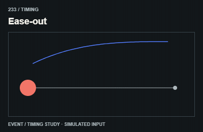

# 233 — Ease-out

Giảm tốc

**Category:** Timing · **Kind:** timing

## Implementation recipe

Use a concave easing curve, for example one minus the cube of one minus p.

This changes how another effect plays. Compose it with a visible property rather than calling it a separate visual effect.

**Starting timing:** compose this controller with a selected visual property; it does not determine the visual design by itself.

## Adaptation checks

End in the intended readable, interactive state. Do not retain a clipped, distorted or transparent final control.

Apply this timing to a real property or timeline. Match endpoints and settlement; do not trigger business events on repeated timeline ticks.

Verify a real intermediate frame and the settled state; do not infer visible movement from a class or animation object alone.

## Demo source

[Deterministic renderer](../../assets/catalog/demo-engine.mjs): zero-based group 23, branch 2. Call `drawDemo(context, 233, normalizedTime)` on a 400 × 260 Canvas. The full source is study material; port only the selected mechanism into production.

[Group GIFs](24-timing.md) · [Catalog index](../catalog.md) · [Reliability](../reliability.md)
