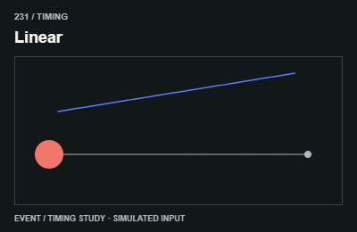
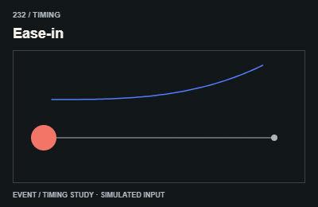
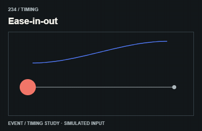
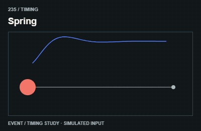
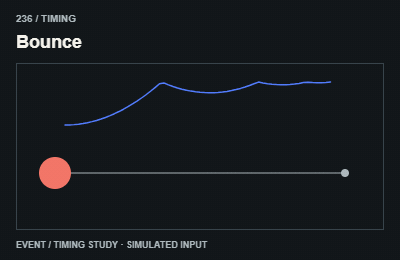
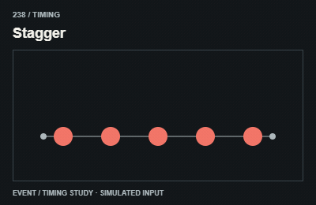
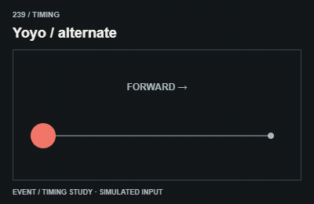
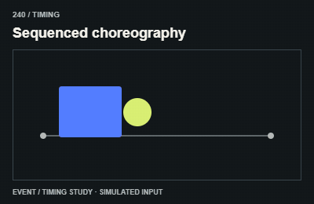

# Timing / Nhịp và easing

This changes how another effect plays. Compose it with a visible property rather than calling it a separate visual effect.

The GIFs are compact teaching studies. Keep the host application state separate from their visual timelines.

[All 240 entries](../catalog.md)

| ID / effect | GIF |
| --- | --- |
| [231 · Linear](231-linear.md) Tốc độ đều |  |
| [232 · Ease-in](232-ease-in.md) Tăng tốc |  |
| [233 · Ease-out](233-ease-out.md) Giảm tốc |  |
| [234 · Ease-in-out](234-ease-in-out.md) Tăng rồi giảm tốc |  |
| [235 · Spring](235-spring.md) Nhịp lò xo |  |
| [236 · Bounce](236-bounce.md) Nhịp nảy |  |
| [237 · Elastic](237-elastic.md) Đàn hồi |  |
| [238 · Stagger](238-stagger.md) Lệch nhịp |  |
| [239 · Yoyo / alternate](239-yoyo-alternate.md) Thuận rồi ngược |  |
| [240 · Sequenced choreography](240-sequenced-choreography.md) Nối nhiều chuyển động |  |
